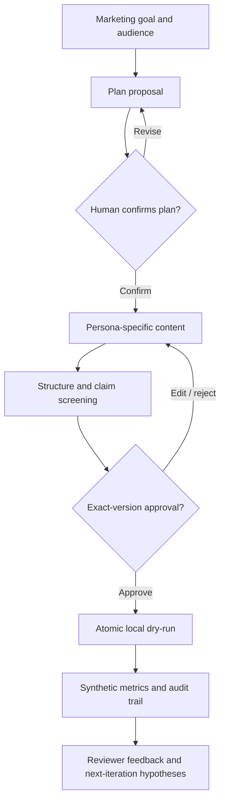

# NovaMind AI Growth Agent

**A plan-first, evidence-aware AI marketing copilot — Python · SQLite · Streamlit · Human-in-the-loop**

> **Portfolio / educational prototype, not a production marketing platform.**
> Default demo mode is deterministic and completely offline. It generates **synthetic**
> contact-engagement data, **never sends live emails**, and does not imply measured customer growth.

## Why this exists

Content-generation demos can write emails, but they do not answer how a team should
review a plan, validate a marketing claim, track the exact approved version, or
avoid duplicate campaign execution. NovaMind explores that product-design space:
**human judgment governs marketing actions while a planning layer prepares and adapts drafts.**

This project originated as a fixed content-marketing pipeline and evolved across
V1–V4 into a plan-first prototype. The public repository contains the **V4 working
source**, not previous binary releases or customer records.

## Product experience



**Implemented:** structured CampaignPlan; editable plan revisions and confirmation;
compiled CTA constraints; rule-based claim screening with local reviewer attestations;
SQLite version/audience hashes and approval gates; atomic local synthetic dispatch;
reviewer feedback memory; product telemetry; Streamlit prototype.

**Optional but not externally validated:** OpenAI Agents SDK read-only planning
(`--planner agent`) and online LLM content generation (`--mode llm`).

**Not implemented or not tested:** autonomous long-horizon replanning, live HubSpot
sending, production identity/SSO, independently verified marketing claims,
real customer conversion attribution, and live-model evaluation runs.

## Verification

| Evidence | Current status |
|---|---|
| Original V4 deterministic test release | **53 / 53 passed** |
| Public repository tests | Run locally and in GitHub Actions CI |
| Planned real-model Agent scenarios | **0 / 30 executed** |
| Real CRM sends and verified conversions | **0** |

Unit tests cover approval, stale versions, audience changes, concurrent local
execution, claim screening and constrained planning. **These do not measure
real-model Agent reliability or marketing lift.** See
[validation notes](docs/VALIDATION_RESULTS.md) and
[Agent evaluation boundary](docs/AGENT_EVAL_RESULTS.md).

## Quick start (offline, no API key)

**Requirements:** Python 3.11–3.12 recommended.

```bash
python -m venv .venv
# macOS / Linux
source .venv/bin/activate
# Windows PowerShell: .venv\Scripts\Activate.ps1
python -m pip install -r requirements-test.txt

python scripts/public_release_check.py
python evals/run_offline_evals.py
python scripts/demo_offline.py
```

`demo_offline.py` runs a complete plan → confirm → draft → approve → synthetic
execution in a temporary directory. It does not persist a database in the repository.

### Interactive interface

```bash
python -m pip install -r requirements-ui.txt
cp .env.example .env  # Windows: copy .env.example .env
# Edit .env and set LOCAL_DEMO_REVIEW_TOKEN to a private local-only token
streamlit run ui/v4_dashboard.py
```

### CLI plan-first workflow

```bash
python -m app.v4_cli propose \
  --goal "Improve email engagement for small creative studios" \
  --topic "AI workflow automation" \
  --audience "ops_lead,freelancer" \
  --constraint "Avoid the word demo in any CTA" \
  --planner demo
```

From the returned `session_id` and `revision`, use:
`edit-plan` (optional) → `confirm-plan` → `generate` →
`python -m app.main approve` (prompts for local token) →
`python -m app.main send` (**local synthetic execution only**).
For complete arguments see `python -m app.v4_cli --help`,
`python -m app.main --help` and the [V4 workflow spec](docs/AGENT_WORKFLOW_SPEC.md).

## Repository layout

```text
app/                    Product logic, SQLite state, review, planner adapters
ui/v4_dashboard.py      Streamlit workbench
 data/contacts.csv      Six fictional example.com records (synthetic)
tests/                  Deterministic unit/integration tests (53 cases)
evals/                  Local pytest evidence runner and 30 planned live-Agent cases
scripts/                Public safety scan and one-command isolated demo
docs/                   PRD, architecture, security, evidence and portfolio notes
.github/workflows/       GitHub Actions CI for tests and demo
```

### Product management documentation

- [Product requirements (PRD)](docs/PRD.md)
- [Architecture and boundaries](docs/ARCHITECTURE.md)
- [Agent workflow and constraints](docs/AGENT_WORKFLOW_SPEC.md)
- [Evidence governance](docs/EVIDENCE_GOVERNANCE.md)
- [Product decisions](docs/PRODUCT_DECISIONS.md)
- [Success metrics and unit economics](docs/METRICS_FRAMEWORK.md) · [Unit economics](docs/UNIT_ECONOMICS.md)
- [Agent evaluation design](docs/EVALUATION_PLAN.md) · [results boundary](docs/AGENT_EVAL_RESULTS.md)
- [Roadmap](docs/ROADMAP.md) · [PM interview demo script](docs/PORTFOLIO_DEMO_SCRIPT.md)

## Design principles

1. **Safety at the tool boundary.** A model cannot grant itself send permission.
2. **A plan is not approval.** Confirmation of strategy is distinct from exact-version
   approval for a local dry-run.
3. **Evidence has provenance.** Reviewer-provided sources are attestations and may be
   unverified; synthetic observations never become claims of measured conversions.
4. **Auditability and reversible iteration.** Every content revision has an ID and hash.
5. **Build vs. buy restraint.** A deterministic demo is labeled deterministic; online
   autonomy is not implied by a complicated workflow diagram.

## Disclosure / data / license

All contacts use reserved `@example.com` addresses and fictional organizations.
Runtime database, `.env`, generated content, local reviewer secrets, reports and
previous release archives are intentionally excluded from Git. No live marketing
emails can be sent by this V4 implementation. [Security](SECURITY.md).

**License:** Not selected. The repository is available to view, but it does not
currently grant an explicit open-source reuse license. The owner can add one later.
